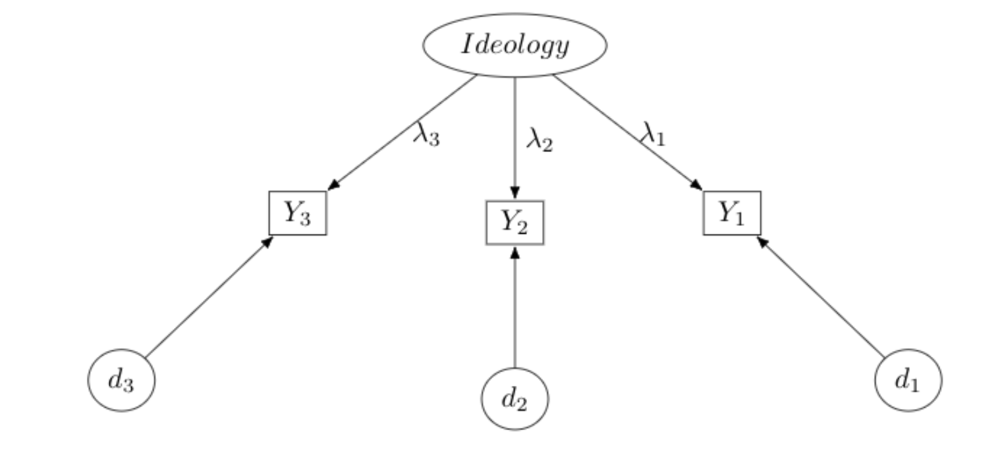
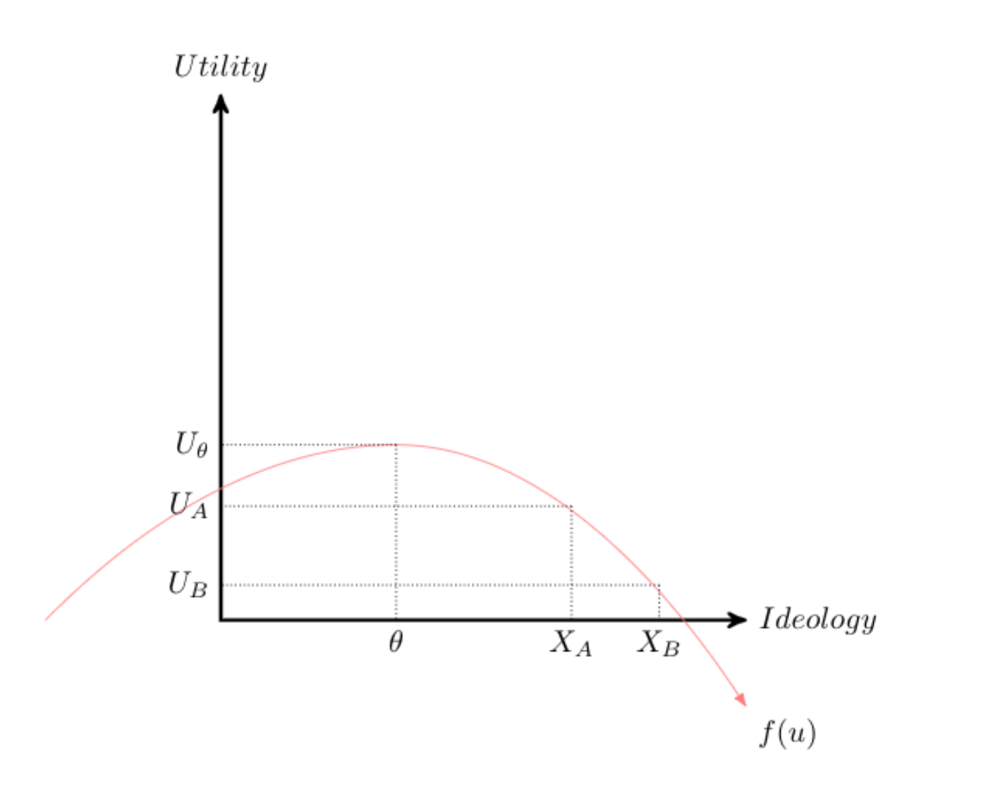
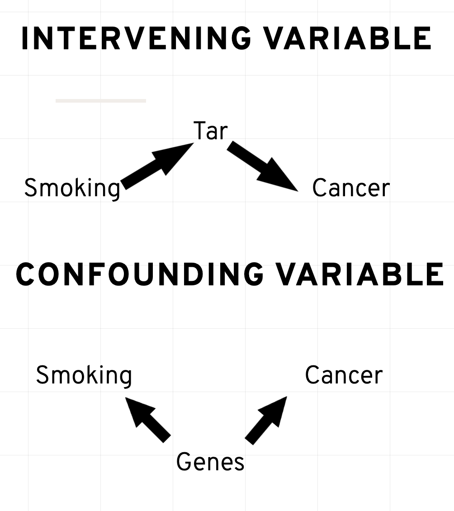

---
output:
  pdf_document: default
  html_document:
    mathjax: default
---

# A Brief Review, and the Logic of Statistical Inference

This class strives to both elaborate and demystify statistical inference. Statistical methodology -- like math instruction in general -- is often taught as a series of techniques, often building on one another. It's common to learn the fundamentals first: calculus, probability, parametric and non-parametric techniques, the basics of hypothesis testing. This typically transitions to an exploration of regression, usually with a focus on linear regression. However, following the Gauss-Markov assumptions, the linear model is often presented as an ideal model if the assumptions are met, and a problematic model if they are not. Issues of endogeneity, collinearity, autocorrelated errors, heteroskedasticity, and measurement errors are often presented as limitations to the model; limitations that often require more advanced techniques.

And that's where we are now. You've now been exposed to a vast amount of technical knowledge. You've learned how to test hypotheses, through group mean comparisons like the *t-test* and *Analysis of Variance*. Similarly, you've learned that you can often test these differences using different distributions, like the *gaussian normal*, the *t-distribution*, the *Fisher distribution*, the *Poisson distribution*, and the *Binomial distribution*. You've also learned that probability is the workhorse of inferential statistics, and can be understood through terms like *marginal probability*, *conditional probability*, and *joint probability*. We rely on these concepts throughout inferential statistics. What is the conditional expectation of y given x (the slope coefficient)? What is the marginal effect of x on y (the average effect)? What is the joint probability of observing x and y? I suspect you've also learned about the *likelihood* and *Bayes' Rule* (also below), and how these two approaches are the foundation of statistical inference.

This course aims to tie together many of these concepts. In McElreath (2020), Figure 1.1 displays the complicated architecture involved in statistical decision making, a flowchart that is often how statistics is taught. It's no wonder that the discipline can seem so intimidating. The goal of this course is to simplify matters, much like McElreath (2020), by drawing on a series of unifying principles that can be used to understand the statistics you've already learned, as well as the procedures covered in this class.

So, for instance, we'll consider the *likelihood principle*/*frequentism* and *Bayesian statistics*. We'll see that while both often reach similar substantive conclusions, the logic underlying these two approaches is quite different. They ask us to say very different things about estimated parameters; they also allow us to approach scientific inquiry in varying ways. For instance, the *Null Hypothesis Test* still quite common throughout the social sciences. One forms an expectation about the data. Then they form a statement that accounts for all other possibilities: The Null. The statistical test involves an estimate as to the probability of observing the null, given the data. These data are used to create a point estimate and standard error. If the null is accompanied by a relatively low probability -- the *p-value* -- the research states with a degree of confidence that they can reject the null. Here's the rub: We're not falsifying the null -- which is central to the basis of hypothesis testing forwarded by Karl Popper, a central figure in the philosophy of science. Instead, we're simply saying that the null is unlikely. Likewise, failing to refute the null does not mean the null is true. *Type II* error is the probability of failing to reject the null when it is false. This type of error can occur when sample sizes are small, for instance. It could be that the alternative (i.e., the researchers) hypothesis is true, but because many statistical tests are influenced by sample size, the test may not produce a statistically significant result.

Adding to the challenges, it is difficult to apply the notion of *repeated observation* central to frequentism in many applied circumstances. A given war under particular conditions only happens once. An election may involve a once-in-a-lifetime choice between two candidates. An landmark policy is only passed once. In these circumstances, the notion of repeated observation is difficult to apply.

Another issue we'll consider -- and one that is important to consider in the context of regression models -- is that of measurement, or *measurement error.* Take for instance the measurement of ideology.



Ideology is a latent (i.e., unobserved) construct. Assume it is measured with three indicators, and we assume these indicators are a functional consequence of one's latent ideology -- an unobservable construct. What is ideology, after all? We need not assume our measures are a perfect representation of the construct, only that they are consequences, with some degree -- perhaps a large degree -- of unobserved error. If $j$ represents the ideology measures ($J=3$), and $i$ is the respondent, we could write a measurement equation:

```{=tex}
\begin{equation}
y_{i,j}=\lambda_j x_{Ideology,i}+d_j
\end{equation}
```
An individual $i$'s score on the $j$th variable is a linear expression of one's underlying ideology and error. This is a very simple measurement model. Note it's just a linear expression, though in this case everything on the right hand side is also unobserved. Think about other concepts. What is party identification but a socially constructed identity to maintain a political coalition? How might we measure this construct? Are these good measures? What about "democracy" and "representation," even gradations of "conflict."



Measurement models are also intimately related and central to many econometric examples. Consider the distribution in the figure above. The red line represents a utility function; we can think of it as a distribution that represenst the utility derived from policies or politicians closest to that point. That is $\theta$ corresponds to an "ideal point"; politicians or policy closest to this point are preferred. We could think of this in terms of ideological space – what is the most valued ideology score? Assume $X_A$ and $X_B$ correspond to ideological positions adopted by two candidates.

Assume this individual prefers A to B, since A is closer. Trace the expected utility on the y-axis for each option and compare it to the ideal point. The individuals earns more utility from A. In fact, the individual should always prefer a candidate that is closest to the ideal point.

Utility maximization is achieved by minimizing the distance between $X_n$, where $n$ is a candidate or policy.

Basically, the individual should prefer the candidate that has the smallest value:

Candidate A: $(x_{A}-\theta)^2$.

Candidate B $(x_{B}-\theta)^2$.

Or, as is commonly written, one should prefer the candidate that maximizes the negative distance

Candidate A: $-(x_{A}-\theta)^2$

Candidate B: $-(x_{B}-\theta)^2$.

But in our formulation, ideology is measured with error, so let's represent measurement error in the equation.

The distance to Candidate A with error is: $(x_{A}-\theta)^2+e_1$.

The distance to Candidate B with error is $(x_{B}-\theta)^2+e_2$.

Let's make the choice more formal, by noting that the probability of preferring Candidate A is

$$ p(Y=A)=[-(x_{A}-{\theta})^2+e_1] - [-(x_{B}-{\theta})^2+e_2] $$

This looks complicated, but let's piece it together. Its putting together everything we already know. If the score is positive, the voter will express a preference for A; if negative B; if zero, indifferent.

Then,

\$\$ \\begin{align} p(Y=A)=&\\theta\^2+x\_{A} x\_{B}-\\theta x\_{A}-\\theta x\_{B} + e_1- e_2 \\nonumber \\\\ =&x\_{A}\^2-x\_{B}\^2+2(x_A-x_B)\\theta+e_2-e_1 \\\\ =&\\alpha+\\beta\\theta+\\epsilon \\end{align} \$\$

The probability of selecting one policy over another is a function of one's underlying, latent ideology score predicting vote choice, in a binary logit model. It's common to assume $\epsilon \sim N(0, \sigma^2)$} What's important to note is that $\alpha$ represents characteristics of the choices, and $\beta$ links the underlying latent score to the policy preference. This form of a "measurement model," again with characteristics of both the chooser and the choice in the equation.

Please see Kevin Quinn and colleagues (e.g., Ho and Quinn 2010; Quinn 2012, and Jessee 2012) work for more elaboration here.

## A Review

### An Introduction to the Directed Acyclic Graph (DAG) {.unnumbered}

First, consider a simple problem. Let's assume we have a dataset with five variables. Each variable has two categories. Suppose we wanted to find the joint probability of these five variables; for convenience, let's label them A, B, C, D, E. To find the joint probability of these five two category variables, this would involve a table with $2^5=32$ entries. Say we switch things to five five category variables. Now there are $5^5=3125$ possible combinations. This is really cumbersome, and can be simplified using a graph structure.

Instead, we can represent the joint probability of these variables in terms of conditional probabilities. Enter the Directed Acyclic Graph (DAG), and its application to causal structures (Pearl 2000).

Consider the following DAG

```{r}
library(dagitty)
library(ggdag)
g <- dagitty("dag {
    A -> B
    A -> C
    C -> D
    D -> E
}")

ggdag(g, text = TRUE) + theme_dag() 
```

$$
p(E,|A, C, D) = p(E|D)p(D|C)p(A)
$$

We should also be clear about notation. Oftentimes, we deal with two variables, $x$ and $y$. We'll often refer to things such as "What is the probability of observing $x$ averaged, or marginalized, across $y$?"

This is relatively easy to envision in a 2x2 table, in which we sum across rows or columns. The appropriate operation is then:

$$p(x)=\sum_y p(x_i, y_i) \hspace{0.5in}  \texttt{Marginal Probability}$$

In the DAG example

The marginal probability of E is

$$
p(E) = \sum_A \sum_B \sum_C \sum_D p(E|D)p(D|C)p(A)
$$

Distributions are also used to describe continuous variables. In fact, much of the applications in this class will assume a continous distribution, even if we only observe a discrete response option. In your first semester statistics course, you reviewed the properties of a variety of continuous distributions -- I assume, the **normal**, **poisson**, **student's t**, **F**, and so forth. One can use calculus -- integration, in particular -- to calculate various areas under the curve. For a continuous bivariate density,

$$p(x)=\int p(x, y) dy \hspace{0.5in}  \texttt{Marginal Probability}$$

The conditional probability of E given A, B, C, and D, can be represented in terms of the above graph, where we simply trace the path from E to A. The graphical representation can often be easier to interpret relative to their associated joint probabilities.

There are also conditional probabilities, not at all different from what was presented graphically. Note the close correspondence between the conditional and joint probabilities.

$$p(x|y)=p(x,y)/p(y)\hspace{0.5in} \texttt{Conditional Probability}$$

where, $p(x)=\sum_y p(x, y)$ or $p(x)=\int p(x, y) dy$. In other words, we are taking the joint probability of two things happening, here $p(x,y)$, and dividing that joint probability by the marginal probability of observing y, $p(y)$. Think of the conditional probability as the joint probability of two events – x and y – weighted by the marginal probability of y occurring.

This representation is really useful, and widely used throughout quantitative methodology. We can represent complicated joint probabilities – the data – in terms of conditional probabilities. Later in the course I'll further develop this structure, explaining how it can be used to develop causal estimands, Bayesian models, and various types of "effects," like the direct, indirect, and total. First, let's explore some basic properties, as this will be useful in building our first regression model.

### A Simple DAG

Let's explore some more characteristics of a DAG. Let's just say our statistical model is $x \rightarrow y$. Then $p(x,y) = p(y|x)p(x)$

What's particularly useful about a graphical structure is that we can represent more complex relationships. We've explored *directed* paths. And often, a variable's effect is conveyed by other variables, and *indirect* path that moves in one direction.

```{r}
dagify(y~x, x~ z) %>% ggdag_canonical() + theme_dag()
```

Because there is no connected path from $z$ to $y$, we can say that $z$ is independent of $y$ given $x$. In practice, if we were to estimate a regression model where $y~a + b_1*x+b_2*z$. We would expect $b_2$ to be zero. Write this as an independence formula. A useful way to write out an independent relationship is

$$z \perp y \mid x$$ Another common way to state this is, "z is conditionally independent of y given x." Another relationship is the **fork**.

```{r}
dagify(y~u, x~u) %>% ggdag()+ theme_dag()
```

Here, $u$ is a fork. It has an effect on two variables, $x$ and $y$. Forks are interesting because they're often described in terms of "confounding variables." Note that in this graph $x$ and $u$ are conditionally independent given $u$.

But failing to condition on $u$, a common cause of both $y$ and $x$ means that if we ignore $u$. The independence will no longer hold.

$$x \not \perp y $$

If we don't condition on the fork -- the confound "u" -- we may find a relationship where none exists. This is why we're often encouraged to specify theoretically informed models, models that "control for" the effect of potential confounding variables.

## An Example: Smoking and Cancer

Up until somewhat recently, the link between smoking and cancer was contested. While epidemiological studies in the 1950s and 1960s suggested a link, doctors, scientists, and health professionals were slower to adopt anti-smoking recommendations and regulations. Elements of the debate were advanced by prominent scientists and statisticians. Indeed, Ronald Fisher -- one of the founders of modern statistics (think F-test, ANOVA, among many others) -- was a regular pipe smoker who was vocal in his opposition to a purported smoking and cancer link, instead propagating (at the time plausible) alternative explanations, like there may be an unobserved variable -- a gene -- that predisposes some to smoking as well as lung cancer (Pearl 2014). Or, what had been a report that a non-trivial number of smokers purported to rarely inhale. It wasn't until 1964 The Surgeon General's Report [on Smoking and Health](https://profiles.nlm.nih.gov/spotlight/nn/feature/smoking) firmly stated there to be a causal link between smoking and cancer in males.

Here is a simplification of the debate.



While scientists had suggested a causal link between $smoking \rightarrow tar \rightarrow cancer$, one argument was that perhaps some unobserved variable, a gene, predisposes people to smoking and developing lung cancer. Let's write out the model with a confounder, genes.

```{r}
dagify(smoking ~ genes, cancer ~ genes, 
       labels = c(
  "cancer" = "Cancer",
  "tar" = "Tar",
  "smoking" = "Smoking",
  "genes" = "Genes"
)) %>% ggdag(text = FALSE, use_labels = "label")  + theme_dag()

```

Note that such a common cause implies that

$$smoking \perp cancer \mid gene $$ A common way to say this is that smoking is *d-separated* from cancer by conditioning on genes.

```{r}
dagify(smoking ~ genes, cancer ~ genes, 
       labels = c(
  "cancer" = "Cancer",
  "tar" = "Tar",
  "smoking" = "Smoking",
  "genes" = "Genes"
)) %>% ggdag_drelationship(from = "smoking", to  = "cancer", controlling_for = "genes", text = FALSE, use_labels = "label") + theme_dag()
```

Recall, this is the definition of independence.

$$p(x,y)=p(x) p(y) \hspace{0.5in}  \texttt{Independence}$$

This is actually quite intuitive if you think about it. If $p(x)$ and $p(y)$ are entirely unrelated -- knowing one does not help you know the other -- then the probability of observing the two events is simply the product. If I flip a coin from 1989 and one from 1977, the flips are independent. Knowing the outcome of the 1989 coin flip is inconsequential for the outcome of the 1977 coin flip. By extension, if two events are independent, then the conditional probability $p(x|y)=p(x)$. Think briefly about what this means in context of the coin flip. Given that the Canadian coins is head, what is the probability that the 1989 coin is heads?

Returning to the example, if we don't condition on "genes", the two will be **d-connected**.

```{r}
dagify(smoking ~ genes, cancer ~ genes, 
       labels = c(
  "cancer" = "Cancer",
  "tar" = "Tar",
  "smoking" = "Smoking",
  "genes" = "Genes"
)) %>% ggdag_drelationship(from = "smoking", to  = "cancer", text = FALSE, use_labels = "label") + theme_dag()
```

Another type of fork is the **inverted fork**. The inverted fork is just that. Instead of multiple arrows extending away from a common node, multiple arrows point to that common node.

```{r}
dagify(y~x+ z, m~z+y) %>% ggdag() + theme_dag()
```

This is a common problem in the social sciences; it forms the basis for mediation analysis. Notice that $z$ can affect $m$ in a couple ways. One is $z\rightarrow m$. Another is $z \rightarrow y \rightarrow m$. The problem is that $y$ is a function of $x$ and $z$. $y$ is a **collider** variable. Perhaps we estimate a model where $m$ is the outcome, $z$ and $y$ are predictors. The consequence of conditioning on a collider $y$ is that we open a path to $m$ that is unintended.

```{r}
dagify(y~x+ z, m~z+y)  %>% ggdag_drelationship(from = "z", to  = "y", control = "m", text = TRUE) + theme_dag()
```

$x$ and $y$ are unrelated, but they're **d-connected** by conditioning on $y$. This is a problem, conditioning on a collider introduces bias, and correlations where none exist.

Let's consider a different application, from literature on advertising and political turnout (Lau and Pomper 2004; Ansolabahere, Iyengar and Simon 1999). Let's consider the finding that negative advertising influences turnout, mediated by efficacy.

```{r}
library(ggdag)
dagify(turnout ~ efficacy, efficacy ~  negativity, 
       labels = c(
  "turnout" = "Voting",
  "efficacy" = "Political Efficacy",
  "negativity" = "Negative Ad")) %>% ggdag(text = FALSE, use_labels = "label") + theme_dag()
```

But what if,

```{r}
library(ggdag)
dagify(turnout ~ efficacy + knowledge, efficacy ~  negativity + knowledge, 
       labels = c(
  "turnout" = "Voting",
  "knowledge" = "Political Knowledge",
  "efficacy" = "Political Efficacy",
  "negativity" = "Negative Ad")) %>% ggdag(text = FALSE, use_labels = "label") + theme_dag()
```

This is a **collider** problem. Political efficacy is a collider. Including efficacy in the model will bias the parameter estimates. For instance, conditioning on political efficacy will induce a correlation between voting and negativity that doesn't exist. Although they should be independent, they're d-connected by efficacy. Collider bias is different from confounding bias. In the case of confounding bias, one must control for the confounder. In the case of a collider, one should not condition on the collider.

```{r}
library(dplyr)
# simulate data from a dag
dat = dagify(turnout ~ efficacy + knowledge , efficacy ~  negativity + knowledge, 
       labels = c(
  "turnout" = "Voting",
  "knowledge" = "Political Knowledge",
  "efficacy" = "Political Efficacy",
  "negativity" = "Negative Ad")) %>% tidy_dagitty() %>%
  simulate_data(N = 1000,   b.default = 0.5)

# partial correlation
cor(dat$turnout, dat$negativity, method = "pearson")
ppcor::pcor(dat %>% select(!knowledge))$estimate
```

Although negativity has a positive impact absent efficacy, the partial correlation is negative.

## The Logic of Inference

This class involves much more than finding a model that is appropriate for a given data structure. In fact, we will continually be returning to two themes in inferential statistics, the *frequentist* and *Bayesian traditions*. In some circumstances, these two traditions will yield very similar results, though the interpretations vary. During these first two weeks, we'll consider these two perspectives from a theoretical vantage; throughout the rest of the term, we'll review techniques to use these perspectives in inference.

It's worthwhile to understand the motivating principles of these two approaches, prior to digging into technical content. Most likely, many of you have received training in the *frequentist* tradition of probability, which is often credited to Jerzy Neyman, Karl Pearson and Sir Ronald Fisher, among others. The logic here is quite simple: Probability refers to the frequency of an event occurring in a series of trials.

**Frequentism** is actually quite intuitive when applied to circumstances in which we can observe repeated trials. If you flip a coin, the probability of observing heads is 0.5. We can flip that coin in almost identical conditions hundreds or thousands of times. If the coin is fair, flipping the coin 10,000 times should yield approximately 5000 times. Yet, most people would recognize that we'll never flip exactly 5,000. Instead, we'll observe some variation around 5,000.

Or consider the classic example of rolling a die. The probability of rolling a 1 (or any number, with a fair die) is 1/6. This number is of limited value in predicting the outcome of a single roll. Just like 0.5 is of limited value in our ability to predict Heads or Tails. And this is where things trend towards the *subjective*. It's common to use probability as a measure of certainty. If the probability of flipping **Tails** is 0.5, that's akin to saying there's so much random fluctuation that if we repeatedly picked **Tails** we'd be right about half the time. So, 0.5 means we shouldn't be confident in our prediction.

Turning to the dice, what repeated experiments means, approximately 1/6 of those trials will yield a 1. We can calculate multiple events, like which say we roll the die 10 times, and each trial involves rolling two dice, should we bet that at least one of these will yield two 1s? The probability of observing two ones is 1/6 $\times$ 1/6 $=$ 1/36. This implies that the rest of the sample space (i.e., not rolling two ones) is 35/36. Since the rolls are independent, then the probability that **two ones are not observed in 10 trials** is $(35/36)^{10}=0.75$ -- thus one should probably *not* bet on "snake eyes."

```{r, fig.width=2, fig.height=4}
# Load necessary library
library(ggplot2)

# Always set seed for reproducibility
set.seed(123) 

# Simulate draws
n_draws <- 10000
outcomes <- sample(c("H", "T"), size = n_draws, replace = TRUE, prob = c(0.5, 0.5))

# Create a data frame for plotting
df <- data.frame(Outcome = outcomes)

# Plot the results
ggplot(df, aes(x = Outcome)) +
  geom_bar() +
  labs(title = "Coins", x = "Outcome", y = "Frequency") + 
  theme_minimal() + 
  scale_y_continuous(limits = c(0, n_draws/2 + n_draws/4)) 

paste("Of ", n_draws, " draws ",  table(df)[1], " were heads! ")
```

Be sure to set *set.seed(10000)* to ensure reproducibility.

Or, if we expect the coin to be unfair, where the probability of Tails is 0.75, we could simulate that.

```{r, fig.width=3, fig.height=5}
# Load necessary library
library(ggplot2)

simulate_coin_toss <- function(n_draws, prob_heads) {
  # Set seed for reproducibility
  set.seed(123)

  # Ensure probabilities are valid
  if (prob_heads < 0 || prob_heads > 1) {
    stop("Probability of heads must be between 0 and 1.")
  }

  # Calculate probability of tails
  prob_tails <- 1 - prob_heads

  # Simulate draws
  outcomes <- sample(c("H", "T"), size = n_draws, replace = TRUE, 
                     prob = c(prob_heads, prob_tails))

  # Create a data frame for plotting
  df <- data.frame(Outcome = outcomes)

  # Plot the results
  plot = ggplot(df, aes(x = Outcome)) +
    geom_bar() +
    labs(title = "Coin Simulation", x = "Outcome", y = "Frequency") +
    theme_minimal() +
    scale_y_continuous(limits = c(0, n_draws))

    # Return the results (optional)
  return(plot)
}

simulate_coin_toss(n_draws = 100, prob_heads = 0.25)
```

Statistics is often taught from this perspective -- even if not always clearly acknowledge. For instance, a confidence interval is not a statement of certainty regarding whether the derived interval contains the true population value. You were likely instructed, early on, that statements such as "there's a 95% chance the mean falls between <lower bound> and <upper bound>'' is totally wrong. That statement often confused me. The reason is that frequentism hinges on the assumption that the population parameters are fixed. If we were to repeatedly draw samples from a population and calculate a confidence interval, approximately 95% of those intervals would capture the population value value.

In fact, the very logic of inference hinges on the notion of drawing a subset of the population (a sample) and making an inference about the general population from that sample. Yet, the **frequentist** approach forces us to think of the population parameter as fixed -- we simply don't have it because it would be expensive to collect -- and the methods we use to make inferences nearly always hinge on this notion of taking repeated samples from a population. Just recall the **central limit theorem**, **the standard error**, **confidence intervals**, **p-values**, and **Type I** and **Type II** errors. These concepts all rely on the notion of repeated observation; hence, the frequentist'' label. Let's take a step back and consider what this means from the perspective of social science and sampling. Then, I think you'll see what I mean when I use the term **frequentist**.

**A Step Back**

In this class, and really in most everything you've worked on, the focus of the research is rarely on individual observations but rather distributions. We can summarize data, and relationships between variables, based on distributions. For example, recall that in linear regression, one of the assumptions is the error process follows a parametric distribution (often the normal distribution). Moreoever, if we have a dependent variable that is clearly not normal and continuous, then this assumption becomes tenuous.

Recall the differences between a probability density function (PDF) and a continuous density function (CDF). A PDF gives the probability of an occurrence (for a discrete variable) or a range of events (for a continuous variable).

**Notation**

(1) A CDF is written as F(x), or capital greek notation, e.g., $\Gamma(x)$.

(2) A PDF is written in lower case font, f(x), and we can find any area under a PDF by summation (for categorical data), and integration (for continuous data). That is,

$$p(a<x<b)=\sum_i^{K} x_i$$

$$p(a<x<b)=\int f(x) dx$$

As such, $F(\infty)=1$, and $F(-\infty)=0$, and $p(-\infty < x < \infty)=\int_{-\infty}^{\infty}f(x)dx=1$. This is an important principle, which occasionally is forgotten. The sum of the total under a probability distribution (continuous variable) or probability mass (discrete variable) must be 1.

We can extend these ideas further, leveraging these three basic principles to what is known as **Bayes' Rule**, named after the mathematician Reverand Thomas Bayes.

## Conditional Probabilities, Continued: Bayes' Rule

Consider the probability of observing $x$ given $y$. This probability can be expressed as the joint probability of observing $x$ and $y$ divided by the marginal probability of observing $y$. That is,

$$p(x|y)={p(x,y)\over p(y)}$$

We can just rearrange things to find $p(y|x)$. First multiply the equation by $p(y)$

$$p(x|y) p(y)=p(x,y) $$

But, remember, we can find the joint probability, $p(x,y)$ as

$$p(y|x) p(x)=p(y,x) $$

Meaning,

$$p(x|y) p(y)=p(y|x) p(x)$$

Bayes' Rule is simply,

$$p(y|x) ={p(x|y) p(y)\over p(x)}$$

Notice, that we could simply solve this by inverting the rows and columns in the above example.

We'll rely heavily on this basic principle, extending it in a number of interesting ways. For now, it's more than sufficient to simply understand that Bayes' Rule is really just a reordering of what we know about conditional probabilities.

**Why p(y\|x) is important -- but misunderstood**

The **Monty Hall Experiment** comes from the classic game show, "Let's Make a Deal." Here's how it goes. There are three doors. Behind one door is a substantial prize -- a car -- behind the others are goats (undesirable prizes).

The contestant chooses one of three doors, but doesn't open it. The door is announced. The host then chooses a door -- obviously not the one with a car -- opens it, and reveals a goat. The contestant offers the option of staying with their original choice, or switching doors.

*Should the contestant stick with the original choice or switch to the unopened door?*

To begin -- and knowing nothing else,

$$ P(Car, A) = P(Car, B) = P(Car, C)=1/3$$

The contestant's initial choice is arbitrary, as the car is equally likely to be behind any door.

Let's just assume you pick *Door A.* It doesn't matter which one you choose though. The math stays the same.

Now, Monty Hall then opens **Door B**, revealing a goat

Let's now calculate some conditional probabilities.

Firstly, you want to know the **probability that Monty opened door B given the car is behind door A**. Recall, that you chose door A, which means Monty could have opened either door B or door C.

Let's break down the problem. The probability that Monty Hall opens *Door B* given the car is behind *Door A* is 0.5. You choose A, so he can open *either* B or C, and will always pick one with the goat. Why is it 0.5. Monty will open door B if the car is behind either of the remaining doors.

$$ P(OpenB | Car, A) = 1/2$$

We know even more though. What is the probability that Monty Hall opened door B given the car is behind door B? It's zero! Under no circumstance will Monty reveal the door with the car, as that would just mean giving away a car, without any real contestant participation.

$$ P(OpenB | Car, B) = 0$$

The last probability to consider is the probability that Monty opened door B given the car is behind door C.

$$ P(OpenB | Car, C) = 1 $$

This is 1 for a simple reason. If you choose A, and he knows the car is behind C, he will always open B. That's all that's left.

Prepared with this, let's invert the problem. After all, this is what we want to calculate -- considering Monty's choice, what is the probability a car is behind doors A, B, C.

$$p(Car,A|OpenB)?$$ $$p(Car,B|OpenB)?$$? $$p(Car,C|OpenB)?$$

$$p(Car,A|OpenB) = {{(1/3 * 1/2)}\over{(1/3*1/2)+ (1/3*0) + (1/3*1)}} = 1/3$$

$$p(Car,B|OpenB) = {{(1/3 * 0)}\over{(1/3*1/2)+ (1/3*0) + (1/3*1)}}  = 0$$

$$p(Car,C|OpenB) = {{1/3 * 1}\over{(1/3*1/2)+ (1/3*0) + (1/3*1)}}  = 2/3$$ The contestant should switch! Don't worry if you got it wrong. I did -- I still find myself inclined to mistrust the result. By far the most common result is to say it doesn't matter if you switch doors, acknowledging that the car resides behind Door A and B is equal, 0.5. This of course, is incorrect, which we can see with the application of Bayes' Theorem.

```{r}
monty_hall <- function(num_trials = 1000) {
  wins_switch <- 0
  wins_stay   <- 0
  for (i in 1:num_trials) {
    prize_door    <- sample(1:3, 1)
    player_choice <- sample(1:3, 1)
    # Monty must open one of two doors without cars
    monty_opens <- sample(setdiff(1:3, c(prize_door, player_choice)), 1)
    # This is the door if player switches
    switch_door <- setdiff(1:3, c(player_choice, monty_opens))

    if (player_choice != prize_door) {
      wins_switch = wins_switch + 1
    } else if (player_choice == prize_door) {
      wins_stay <- wins_stay + 1
    }
  }
  # Calculate and print the win probabilities
  win_prob_switch <- wins_switch / num_trials
  win_prob_stay <- wins_stay / num_trials
  
  cat("If the player switches doors, they win:", win_prob_switch, "of the time", "\n")
  cat("If the player stays with original choice, they win:", win_prob_stay, "of the time", "\n")
}
monty_hall(10000)
```

## Two Traditions

We will rely on probability densities a lot in this class. There are a variety of ways to describe, or summarize a distribution of data (or a theoretical distribution). Much of this class focuses on probability.

In statistics, we often (albeit not explicitly) use probabilities in a relativistic sense. We think of it as trials or experiments that are repeatable, aka the *frequentist* interpretation. For instance, the estimate of a particular candidate winning the presidential nomination may be 0.55. If we were able to conduct a primary election over and over and over again, in the long run, we are assuming the candidate wins 55 out of 100 times. On any given trial though, they'll either win or lose, just as you'll only win or lose if you play a game of chance.

It's well established in the psychology literature that humans are not great at processing probabilities. Our attention is drawn to emotionally evocative events -- evident in the so called "availability heuristic," and humans don't accurately process base rates, the "accessibility heuristic." For instance, shortly after the September 11 attacks, many Americans chose to drive rather than fly, despite the fact that driving was still far more dangerous -- in terms of fatalities -- than flying. The probability of dying in a terrorist attack in the U.S. has traditionally been far less than dying in an automobile accident

In the social sciences in particular, we use probability in a **subjective** sense, leveraging probability as a statement of certainty. While not inherently problematic, "certainty" means something different in the frequentist tradition, where parameters are fixed and we sample from a population.

When we fit a model -- perhaps by minimizing the sum of squared residuals -- we are generating a statement about the ability of our data being produced by a particular model, $p(Y|M)$. Since we're thinking about this broadly, let's swap out $Y$ for $D$, where $D$ is the model. This is essentially what we do when we compare model fit, examining how the overall model changes in its predictive power. The problem is we may be inclined to make a statement about the model given the data. This term is called the "likelihood" -- what is the probability of observing the data, given a model.

What is the probability, for instance, that a parameter falls in a particular range? The likelihood provides little help here. In a frequentist application, we can't make such a statement. We can only say, "If we were to repeatedly draw samples from the population, the parameter should fall in this approximately 95% of the time." This is the basis of the confidence interval. It's a statement about the long-run properties of the estimator. If we wanted to say something about different, we would need to calculate the inverted probability.

Again, let's refer to $M$ as the model, and $D$ as the data.

$$p(M|D) ={p(D|M) p(M)\over p(D)}$$

The inverse probability is then a function of the likelihood, as well as the probability of observing the model \emph{and} the probability of observing the data. It turns out that since the denominator is a normalizing constant, which renders the numerator into a valid probability, it is proportional to the product absent $p(D)$.

$$p(M|D) \propto p(D|M) p(M)$$

What this establishes is these two principles: Frequentism versus Bayesian inference. Typically, we're interested in the Bayesian version of the probability statement -- "what is the probability that our data produced a model?" The frequentist version, which draws on what is called the likelihood, really posits something different, and that is, "what is the probability that a model produced our data?"

You may have made a similar error when thinking about the Monty Hall experiment. We can ask $p(car|door)$ and we can also ask $p(door|car)$ These are quite different. The first is the probability that the car is behind a door, considering Monty opens a door with a goat. The second is the probability that Monty will choose a given door, given a car is behind it. Because Monty is choosing in a strategically predictable way, we can see that $p(door|car)$ is not uniform.

In fact, we'll just focus on likelihood for a bit, because we've not addressed a critical point: We often don't know the population parameter, but estimate it from data. This is where we pair the likelihood principle with algorithms to maximize the probability of observing the data given the model. This is *maximum likelihood*.

## Bernoulli Trials

    Let's start with coin flips. We're going to operate from the assumption that a coin is fair, which simply means the probability of observing an H is the same as the probability of observing T. In this case, $y \in [0 , 1]$. Let's say:

$$y = {1, H, \theta=0.5}\atop  {y=0, T, 1-\theta=0.5} $$

So, we're just labeling heads 1, tails 0. Each has an equal probability. Let's call this population parameter governing the behavior of the coin, $\theta$. This isn't a trivial assumption -- it's central to *frequentist* inference -- the parameter is fixed. The assumption is it exists, and governs the behavior the coin. Because we know what $\theta$ is, by assuming the coin is fair, it is easy to find the probability of observing a particular string of heads, tails, or some combination.

Let's also assume independent trials. What this means is one trial is independent of a subsequent trial. Then the joint probability of observing a (H,H) is simply $0.5 \times 0.5=0.25$.But, perhaps we have some reason to expect the coin is not fair, and $\theta=0.3$ (the coin is biased in favor of T). Then, the probability of observing a H,H,T is $0.3 \times 0.3 \times 0.7$. Recall from the previous section we could simply express these independent coin flips in a formal expression, as

$$p(heads)=\theta^y(1-\theta)^{1-y}$$

And, across $n$ independent trials trials,

$$p(k)=\prod\theta^y_i(1-\theta)^{1-y_i}$$ $$=\theta^k(1-\theta)^{n-k}$$

Since $\textbf{y}=y_1, y_2...y_n$ is observed and we are making an assumption about the constituent probabilities, all we need to do is multiply the probability of each outcome, here denoted by $\prod$

Likewise, we could just use the binomial distribution to calculate this probability (call $K$ an observed sequence).

$$p(K | \theta, N)= {n \choose k} \theta^K(1-\theta)^{N-K}$$

## When $\theta$ is unknown

Turn the question of coin flips on it's head (my apologies). We've assumed that $\theta$ is known, allowing us to generate a valid probability distribution for some observed sequence. However, $\theta$ -- the statistical parameter -- is usual what we want to estimate. It exists in the population, but it is not directly accessible. However, we assume it could accessed, if we had resources to access the total population -- like a *census*. Of course, we rarely can access the whole population -- if we could, what would be the point of inference -- and instead we make an inference about this parameter. It's perhaps easiest to consider with coin flips. For a given coin, we assume $\theta$. If we approach the trials with an assumption of a fair coin, we simply posit that $\theta=0.5$. But, what if we are not able to generate such a concrete assumption about $\theta$?

Instead, suppose we only have access to an observed series coin flips. Instead of approaching the problem from the issue of, *What is the probability of observing two heads in a series of 10 flips, given a fair coin?* we might ask, "Given 2 observed heads out of 10, what is the most probable value of $\theta$"? Or, "Is the coin fair?" It shouldn't take much convincing that this is a qualitatively different question. It's also the question we commonly ask ourselves in applied research. In particular, **Given the data available, what is the most likely parameter or set of parameters to generate the data?** In this case, "parameter" may be an estimate about how many people will vote for a candidate, a slope coefficient, and so forth. An alternate way to think of this is $p(D|M)$ -- or what is the probability of observing the data, given the model (King 1998).

Although you may not have seen this notation yet, our statistic models often assume we want to maximize the likelihood that an estimated population value produced a data set, called $D$, so $p(D | \theta)$. This is also why I've been following this convention. Consider the logic of minimizing the sum of squared errors. If $\theta$ simply represent a vector of slope coefficients, recall that the logic of OLS is to minimize the squared discrepancy between the observed and predicted values. Though we can estimate an infinite number of $\theta$ values, only one will meet the criterion of minimizing the sum of squared residuals. This is equivalent to asking ourselves, \`\`what is a set of $\theta$ values that maximizes the likelihood of observing a particular dataset?'' in that finding $\theta$ that minimizes the sum-of-squared residuals will also maximize the probability of observing a particular dataset.

This is the logic underlying a technique that we will use throughout this semester, which is called "maximum likelihood." In the linear model, the maximum likelihood estimator and the OLS estimator will yield the same results; yet, the logic of minimizing SSR is not applicable to many other data situations (e.g., a binary dependent variable). Thus, we may use the logic of ML to estimate a variety of models.

Returning to the motivating example: What is $\theta$ in a series of coin flips. Maximum likelihood is a technique to estimate parameters in a model, not unlike the principle of least squares. The logic -- and not so much math -- is as follows. Let's call $\theta$ some set of parameter estimates and $D=(y_1....y_n)^T$ is the observed data. The probability of observing vector, $D|\theta$ is simply the product of all individual values of $y_i | \theta$, if values are independently observed. Thus, the probability of observing H,H,T with a fair coin is simply $0.5 \times 0.5 \times 0.5$.

## Simulation and the Likelihood Function

Assume we observe 7 heads, 3 tails. What's our best guess of theta?

```{r}
library(ggplot2)
theta <- seq(0, 1, by = 0.01)
# The likelihood function, using bernoulli trials
likelihood <- theta^7 * (1 - theta)^3
df <- data.frame(theta, likelihood)

max_likelihood_theta <- df$theta[which.max(df$likelihood)]

ggplot(df, aes(x = theta, y = likelihood)) +
  geom_line() +
  geom_vline(xintercept = max_likelihood_theta, color = "red", linetype = "dashed") +
  labs(title = "Likelihood Function for 7 Heads and 3 Tails",
       x = "Theta (Probability of Heads)",
       y = "Likelihood") +
  theme_minimal()

cat("Possible values of theta:", paste(head(theta), collapse = ", "), "...\n")
cat("Assume we observe 7 heads, 3 tails. What's our best guess?\n\n")
cat("The maximum value of the distribution is at theta =", max_likelihood_theta, "\n")
```

Instead of having a known probability, we can work the other direction and calculate the most likely value for $\theta$ given an observed data set. To keep things tractable, assume 10 flips, and we observe 7 heads. That is, $L(\theta | \sum y_i=7, N=10)$ -- we may generate a value for $\theta$ that maximizes the probability of observing 7/10 heads.

Formally, $$L(\theta)=\Pi p(y_i | \theta)$$.

Thus, the likelihood equation is the probability of observing $y$ given some **best guess** of $\theta$. Below, we'll very briefly develop a few techniques to formulate this guess

We've now observed the data, and instead of knowing $\theta$, we can estimate the most plausible value of $\theta$, considering our data. If we flip a coin ten times and observe seven heads, what is a value of $\theta$ that is most likely to produce this sequence of results? It's 0.7; the maximum likelihood estimate of $\theta$ is 0.7.

All the code does is take the probability of observing a head at each trial and multiplied these together. If we simulate values of $\theta$, we find a single peaked function with a maximum value of 0.7.

In particular, we have identified a value of $\theta$ in the population that was most likely to produce the observed data. In other words, we assume:

$$p(y|\theta)=\prod_{n=1}^Np(y_n|\theta)=\prod_{n=1}^N\theta^{y_n}(1-\theta)^{1-{y_n}}$$ (Bishop 2006, page 69).

If the sequence of results is ${H,H, T, H, T, T, T, T, T, T}$, if $\theta=0.1$, then we multiply $0.1 \times 0.1 \times 0.9 \times 0.1 \times 0.9^6$. By doing this for every value of $\theta$, we want to find the highest probability associated with $\theta$. This is precisely the logic of maximum likelihood: Observe a dataset and find a value of $\theta$ that is most likely to have produced that dataset. What you can see is that the function is peaked. There is only one value that maximizes the \`\`likelihood function'' which is simply:

```{=tex}
\begin{eqnarray}
p(y|\theta)=\prod_{n=1}^Np(y_n|\theta)=\prod_{n=1}^N\theta^{y_n}(1-\theta)^{1-{y_n}}
\end{eqnarray}
```
I've solved the problem with a simulation. In fact, that's not required. In this case, there is a closed form solution to the problem. In particular, we take the logarithm of the likelihood function, and solve by taking partial derivatives and setting these values to zero.

In this example, you've probably noticed that the maximum likelihood estimate for $\theta$, given $n$ Bernoulli trials is simply $k/n$, where $k=\sum y_i$. We'll rely on this logic throughout the semester -- and we'll extend this considerably -- but for now it's really just important to conceptually understand the motivation, which is to find the most likely value of $\theta$ that produced the observed distribution of data.

As King (1998) notes, "**Maximum Likelihood Estimation** is a theory of point estimation that derives in this very direct way from the likelihood function. The maximum is not always a very good summary of the entire likelihood function, but it is very convenient and often useful" (p. 24)

## Appendix

### A Quick Review

**Correlated random variables**. Assume we observe two variables, $x$ and $y$. They have means $\mu_x$ and $\mu_y$ and standard deviations, $\sigma_x$ and $\sigma_y$. The mean of $x+y$ is $\mu_x+\mu_y$.

The standard deviation is $\sqrt{\sigma^2_x+\sigma^2_y+\rho\sigma_x\sigma_x}$, where $\rho$ is the correlation between the variables (Gelman and Hill 2009, p.14). In R, we can test this

```{r}
x <- rnorm(1000, 0, 1)
y <- rnorm(1000, 0, 1)
# Added means
mean(x) + mean(y) 
# Means of added variables
mean(x + y)
```

We often assume the two variables follow a multivariate normal distribution, $z_k \sim N(\mu_k, \Sigma_{kk})$. $\mu_k$ represents the means of the random variables, $\Sigma$ represents a covariance matrix, with variances on the diagonal and covariances on the off diagonal.

```{r}
library(MASS)
library(dplyr)
library(ggplot2)
# A covariance matrix (correlation because var = 1)
cov = matrix(c(1, 0.25, 0.25, 1), 2, 2)
## Simulate 1000 draws and plot
x <- mvrnorm(1000, mu = c(0, 0), Sigma = cov) %>% data.frame()
head(x)
colnames(x) <- c("X1", "X2")  # Rename columns for clarity

ggplot(x, aes(x = X1, y = X2)) +
  geom_point() +  
  labs(title = "Scatter Plot of Bivariate Normal Data, rho = 0.25",
       x = "Variable X1",
       y = "Variable X2") +
  theme_minimal()  

paste0("The estimated correlation is " , round(cor(x)[2,1], 3))
```

Recall the **central limit theorem** states that by drawing repeated samples and calculating the means, then the distribution of sample means will be approximately normal. A \emph{sampling model}, which we commonly work with, is a model applied to a sample from a population; we in turn use that model to make an inference about a population. In fact, a test-statistic or estimand is used in this model to draw an inference about a **population parameter**. Statistics are often called parameter estimates.

The **standard error** of a statistic represents uncertainty about the parameter estimate (though see above caveats). In the case of a mean, recall that the central limit theorem allows us to estimate the standard deviation of sample means, $\sigma/\sqrt{n}$. When dealing with proportions, the standard error is $\sqrt{p(1-p)/n}$. Say we are interested in the difference between two proportions, we must then calculate the standard deviation of the differences, or $\sqrt{sd_{p1}^2+sd_{p2}^2}$

**The Expected Value**. The expected value is the **average** value over many draws -- it's useful to think of it from the perspective of frequentism. For a discrete distribution, then:

$$E(x_i)=\sum_{i}^{K} x_i p(x_i)$$

Again, this doesn't tell us anything about a single, or even predicted, $x_i$ value. It is the value of $x_i$, weighted by $p(x_i)$. Take a simple example, flipping a coin. Let's say $H=Y=1$, $T=Y=0$. As such, if we flip a coin 10 times, then $E(Y_i)=\sum y_i  f(y)=(0.5)^{10}$. You may also write it as \$E(x_i)=\\sum_i\^{K} x_i f(x_i)\$.

We have conceptually the same thing for a continuous variable, where

$$E(x)=\int_{-\infty}^{\infty}x f(x)dx$$.

Again, it's simply the sum of the occurrence weighted by the probability of that occurrence. If $y=f(x)=a+bx$, where $a$ and $b$ are simply constants, then $E(y)=E(a+bx)=aEx+b$. The expected value of a fixed value or constant value is a constant. You should recognize this from your linear regression course, $E(Y)=a+b\bar{X}$.

### Properties of Estimators

We're often concerned with making inferences about a population from a sample. Recall, in the frequentist tradition, we think of parameters as fixed characteristics of the population; statistics are derived from sample(s) drawn from the population. They are often qualified with some degree of uncertainty. An estimator is the formula or equation used to represent what we think is the process governing a parameter. So, $y_i=\alpha+\beta x + \epsilon$ forms the relationship between x and y in the population, governed by fixed parameters $\alpha$, $\beta$, and an error term. This is not the estimator. The estimator is the method we then use to guess these parameters. Ordinary least squares is an estimator. It's one of many estimators.

The issue is that we only have a sample, or set of samples. Thus we wish to draw an inference about the population from the sample. The properties of an estimator can be explored in myriad ways. One method to assume a sample is observed over repeated trials, so we have repeated samples. We could then perform our estimation procedure across samples and compile these estimates. Recall the logic of the central limit theorem, for instance.

If we were able to repeatedly draw samples and run our estimation procedure, we are left with a \textit{sampling distribution}. We can then explore properties of an estimator by examining this distribution. Most notably, the distribution will have mean

$$E(\hat {\theta})$$

$$var(\hat{\theta})=E(\hat{\theta}-E(\hat{\theta}))^2$$

With $\sqrt{var(\hat{\theta})}$ as the standard deviation of the sampling distribution. We can then establish three statistics to explore the properties of an estimator. The *sampling error* is the deviation between our estimator $\hat{\theta}$ and the population parameter ($\theta$). There will always be some degree of error by drawing a sample from a population. We may wish to minimize this sampling error, but we shouldn't expect it to be zero.

**Bias** is the difference between the expected value of an estimator relative to the true population parameter, i.e., $\hat{\theta}-\theta$. Note how this is different from the sampling error. The sampling error refers to the difference for a single estimate produced from our estimator. Bias is the average of many samples analyzed with an estimator.

We're often also interested in how much an estimator varies about a true population parameter. Here, let's define the **Mean Squared Error** (MSE), or $E(\hat{\theta}-\theta)^2$. Again, notice the difference here. Here, we are concerned with how much an estimator varies around the true population parameter. It can be shown that the MSE may be rewritten as

$$E(\hat{\theta}-E(\hat{\theta}))^2 +[E(\hat{\theta}-\theta)]^2$$

In other words, the MSE is a function of the variance of the estimator and the bias of the estimator. We generally wish for this value to be small. For instance, if we were to compare two estimators, we should prefer the estimator that is unbiased with minimum variance, which of course translates to having the smallest MSE.

### Finite Sample Properties

Ordinary Least Squares has desirable **small sample properties**. What does this mean? Some estimators are unbiased or have minimal variance even when a sample is small.

For instance, unbiasedness is $E(\hat{\theta})=\theta$. Over repeated samples, the mean of the sampling distribution will converge upon the true population parameter. Although it may seem that unbiaseness alone is enough to prefer one estimator over another, it's not. The reason is that it is a property of repeated samples. Again, if we only collect one sample, we have no idea if a parameter estimate is near the true population value. To ascertain whether an estimator is unbiased, we examine it's properties over repeated trials.

Efficiency, os

$$var(\hat{\theta})<var(\tilde{\theta})$$.

This means that compared to other estimators, our preferred estimator should have smaller variance.

In some cases, there is a tradeoff, in that we may have an estimator that is known to be biased, but it has smaller variance. That is, in some circumstances, we may even prefer some degree of bias, if our estimator has minimal variance. We'll often rely on a statistic called the *Mean Squared Error* to compare estimators.

$$MSE(\hat{\theta})=E(\hat{\theta}-\theta)^2$$ The squared expected difference between the estimator and the true population parameter. The MSE is a function of the variance of the estimator and the bias of the estimator.

$$MSE(\hat{\theta})=var(\hat{\theta})+[E(\hat{\theta}-\theta)]^2$$ Some estimators we'll explore in this class have small variance, but some bias. Examples are **ridge** and **lasso** regression. These estimators may be preferred to OLS, which is unbiased, but may have larger variance because of multicollinearity, for instance.

***The Bias Variance Tradeoff***

By now, you should be intimately familiar with a traditional linear equation.

$$Y_i=\beta_0+\beta_1 x_{1,i}+\beta_2 x_{2,i}+\dots+\beta_k x_{k,i}+e_i$$

We can find these parameters by minimizing the residual sum of squares.

$$RSS=\sum_{i=1}^N=Y_i-(\beta_0+\beta_1 x_{1,i}+\beta_2 x_{2,i}+\dots+\beta_k x_{k,i})$$ A problem that often arises in practice is that of collinearity -- with finite samples, it is not uncommon to find that some variables are (imperfect) linear combinations of other variables, which doesn't necessarily affect the parameter estimates, but will grossly exaggerate the standard errors.

We end up with an unbiased, but inefficient estimate. This is not ideal. First, we cannot effectively test hypotheses and second unless the model is strongly informed by theory, it is possible that we could drop a variable. Of course, we know that if we drop a variable that should be in the model, then we risk biased estimates. This is one issue that is very common in applied statistics; theory may not always be informative enough to tell us exactly how to specify a model. Still, if we include irrelevant variables, this will lead "overfitting" whereby our "out-of-sample" predictions (think election forecasting) will be off.

This is a tradeoff we'll discuss repeatedly throughout the term. It's commonly called the bias-variance tradeoff. Some estimators may be unbiased, but inefficient, and vice-versa.

### Asymptotic Properties

We can also explore the properties of an estimator by varying the sample size; in particular, what happens to the estimator as the sample size approaches infinity? As the sample size gets larger and larger, what happens to the characteristics of an estimator?

An estimator is said to be *asymptotically unbiased* if

$$\lim_{n\to\infty} E(\hat{\theta})=\theta$$

A perfect example of this is the estimate of the sample variance; you may recall that the population variance is:

$$\sigma^2={{1}\over{n}}(x-\mu_{x})^2$$

But the sample variance is:

$$\sigma^2={{1}\over{n-1}}(x-\bar{x})^2$$

The population variance is an unbiased estimator as the sample size increases. In particular,

$$\lim_{n\to\infty} E(\hat{\sigma^2})=\lim_{n\to\infty} [{{n-1}\over{n}}]\sigma^2=\sigma^2$$

Note that as n approaches infinity, the term $[{{n-1}\over{n}}]$ approaches 1 and the estimator converges to the population parameter.

An estimator is said to be *consistent* if:

$$P\lim_{n\to\infty}(|\hat{\theta}-\theta|<d)=1$$

then,

$$Plim_{n\to\infty}(\hat{\theta})=\theta$$

Really, this is subtly different from asymptotic unbiasedness. What it means is that the probability that the estimator is not different from the population parameter is 1 as the sample size approaches infinity. Put slightly different, the probability increases to 1 that as the sample size increases the estimator converges to the population parameter.

We sometimes refer to this as the bias/variance trade off. A prime example is the variance estimate above. When we divide by $n$ this is also called the MLE estimate of the variance. It is biased in small samples, but consistent and asymptotically unbiased. I like to think of consistency more in terms of the variance of an estimator, such that $P\lim_{n\to\infty}$ represents the point at which the variance is 0 and the entire distribution collapses to one value -- i.e., $\lim_{n\to\infty} MSE(\hat{\theta}=0)$
